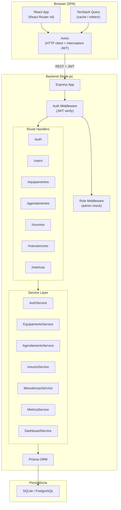
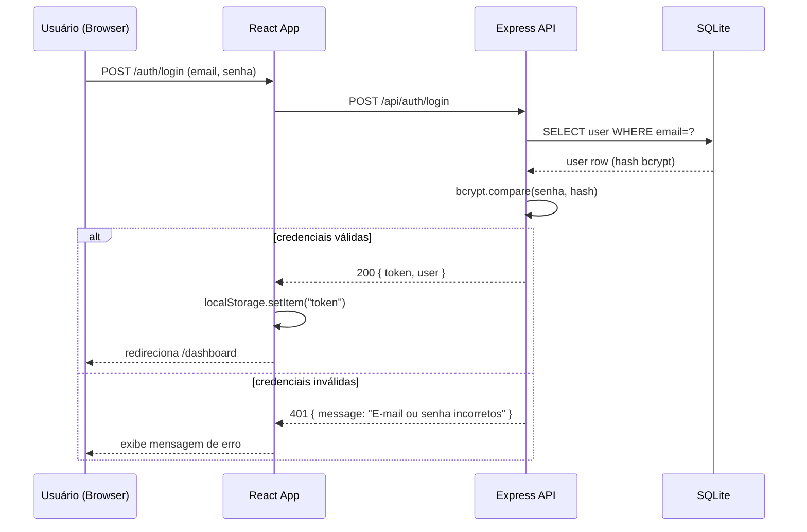
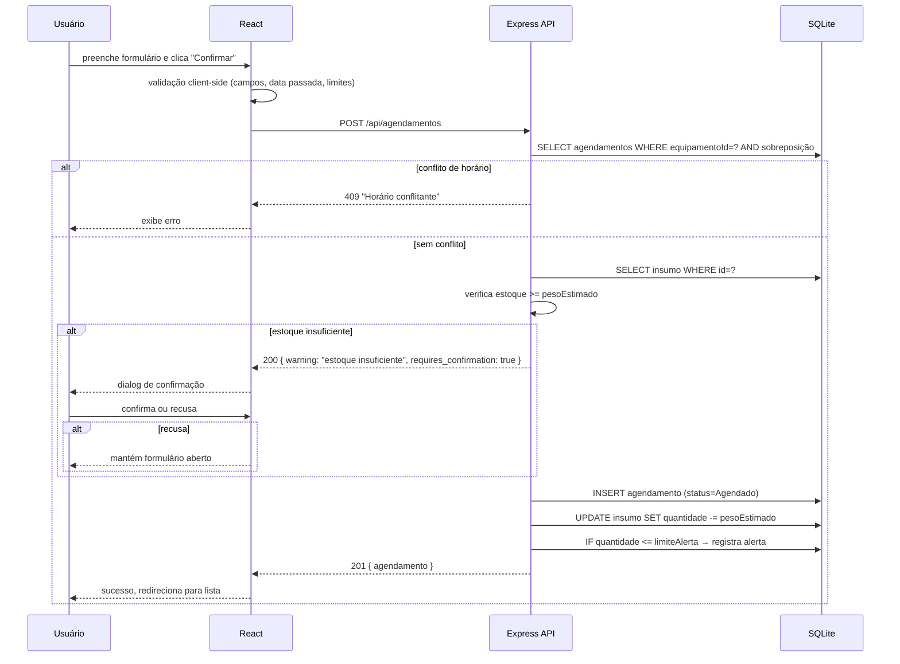
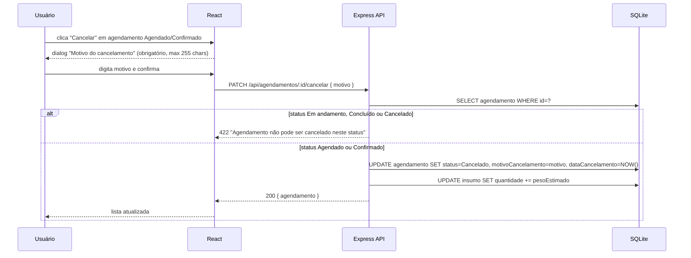
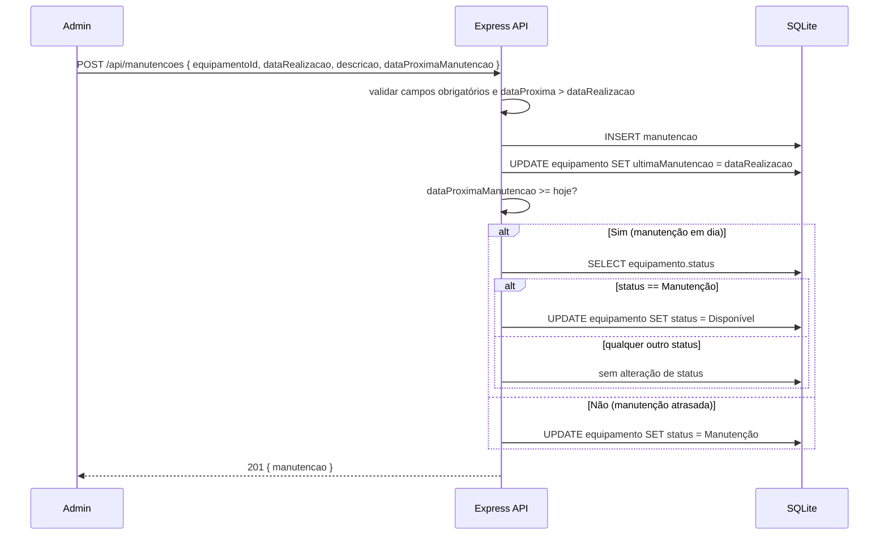
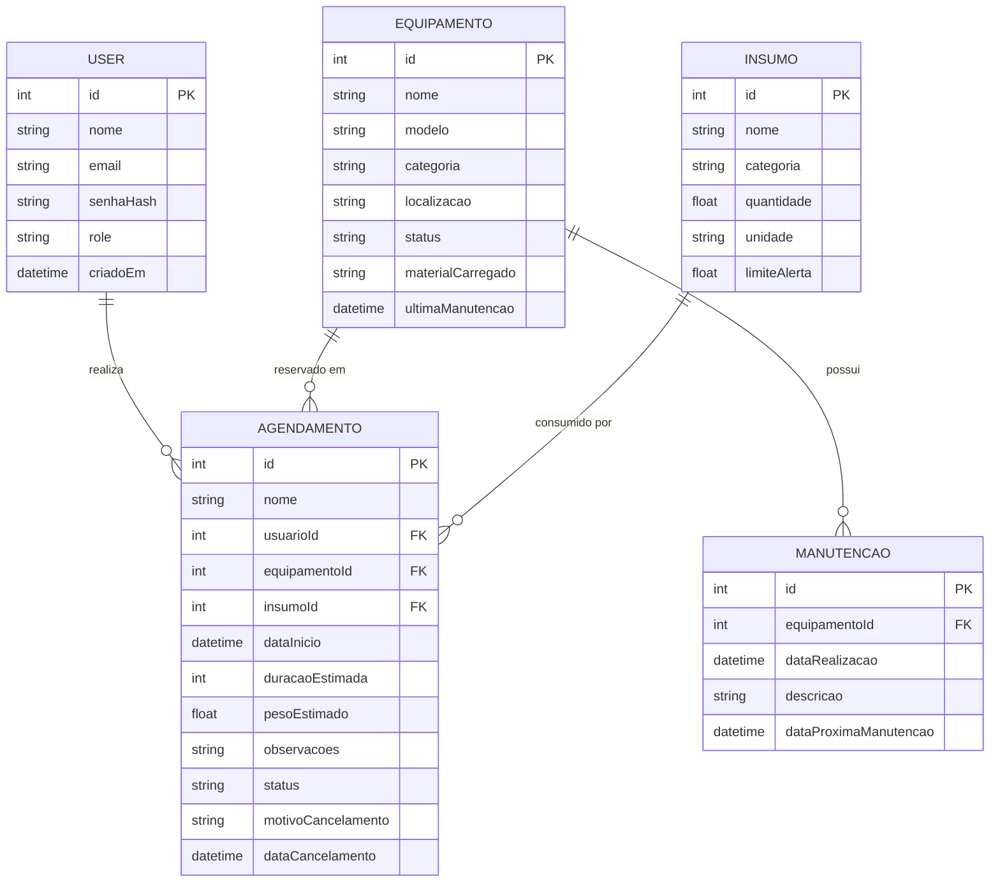

# Design Document

## Overview

O SIGES é uma aplicação web full-stack composta por um frontend SPA em React e uma API REST em Node.js/Express, persitindo dados em SQLite (ambiente acadêmico/desenvolvimento) com opção de migração para PostgreSQL em produção via ORM.

O sistema serve dois perfis: **usuário comum** (realiza agendamentos e acompanha o próprio histórico) e **administrador** (acesso pleno a equipamentos, insumos, manutenções e métricas). Toda comunicação entre frontend e backend passa pela API REST protegida por JWT.

### Banco de Dados

**SQLite** é adotado como padrão por eliminar a necessidade de servidor de banco de dados separado — ideal para contexto acadêmico e execução local. A camada de acesso a dados é abstraída via **Prisma ORM**, cujo schema permite trocar o provider de `sqlite` para `postgresql` alterando uma única linha de configuração sem mudar nenhum código de aplicação.

---

## Architecture

### Visão Geral de Componentes



### Fluxo de Autenticação



### Fluxo de Criação de Agendamento com Dedução de Estoque



### Fluxo de Cancelamento com Devolução de Estoque



### Fluxo de Manutenção e Transição de Status do Equipamento



---

## Components and Interfaces

### Estrutura de Pastas

```
siges/
├── frontend/                        # React SPA
│   ├── public/
│   ├── src/
│   │   ├── assets/                  # ícones, imagens estáticas
│   │   ├── components/              # componentes reutilizáveis
│   │   │   ├── layout/
│   │   │   │   ├── AppShell.jsx     # wrapper: Sidebar + Header + <Outlet>
│   │   │   │   ├── Sidebar.jsx      # nav lateral, seções VISÃO GERAL / OPERAÇÃO
│   │   │   │   ├── Header.jsx       # breadcrumb + botão "+ Novo agendamento"
│   │   │   │   └── HamburgerMenu.jsx
│   │   │   ├── ui/
│   │   │   │   ├── KpiCard.jsx      # card de métrica com barra colorida
│   │   │   │   ├── StatusBadge.jsx  # pill colorida de status (Disponível, etc.)
│   │   │   │   ├── StockBar.jsx     # barra de progresso de insumo (azul/vermelho)
│   │   │   │   ├── EquipCard.jsx    # card de equipamento com seleção (borda azul)
│   │   │   │   ├── Pagination.jsx   # paginação genérica
│   │   │   │   ├── Modal.jsx        # modal genérico com overlay
│   │   │   │   └── ConfirmDialog.jsx
│   │   │   └── forms/
│   │   │       ├── AgendamentoForm.jsx
│   │   │       ├── EquipamentoForm.jsx
│   │   │       ├── InsumoForm.jsx
│   │   │       └── ManutencaoForm.jsx
│   │   ├── pages/
│   │   │   ├── Login.jsx
│   │   │   ├── Dashboard.jsx
│   │   │   ├── Agendamentos.jsx     # lista "Meus Agendamentos"
│   │   │   ├── NovoAgendamento.jsx  # formulário em 3 seções
│   │   │   ├── Equipamentos.jsx
│   │   │   ├── Insumos.jsx
│   │   │   ├── Manutencao.jsx
│   │   │   └── Metricas.jsx
│   │   ├── hooks/
│   │   │   ├── useAuth.js           # contexto de autenticação
│   │   │   ├── useDebounce.js       # debounce genérico (300ms)
│   │   │   └── useEquipamentos.js   # TanStack Query hooks por módulo
│   │   ├── services/
│   │   │   └── api.js               # instância Axios + interceptor JWT
│   │   ├── context/
│   │   │   └── AuthContext.jsx
│   │   ├── router/
│   │   │   └── index.jsx            # React Router v6 com ProtectedRoute
│   │   └── main.jsx
│   ├── package.json
│   └── vite.config.js
│
└── backend/                         # Node.js + Express
    ├── src/
    │   ├── routes/
    │   │   ├── auth.routes.js
    │   │   ├── users.routes.js
    │   │   ├── equipamentos.routes.js
    │   │   ├── agendamentos.routes.js
    │   │   ├── insumos.routes.js
    │   │   ├── manutencoes.routes.js
    │   │   └── metricas.routes.js
    │   ├── controllers/
    │   │   └── (um por módulo)
    │   ├── services/
    │   │   └── (um por módulo — lógica de negócio)
    │   ├── middlewares/
    │   │   ├── auth.middleware.js    # verifica JWT
    │   │   └── role.middleware.js    # verifica role=admin
    │   ├── validators/
    │   │   └── (zod schemas por módulo)
    │   ├── prisma/
    │   │   └── schema.prisma
    │   └── app.js                   # Express app + registro de rotas
    ├── server.js                    # ponto de entrada (listen)
    └── package.json
```

### Componentes React Principais

| Componente | Responsabilidade |
|---|---|
| `AppShell` | Layout raiz das telas autenticadas; renderiza `<Sidebar>`, `<Header>` e `<Outlet>` do React Router |
| `Sidebar` | Navegação com seções "VISÃO GERAL" (Dashboard, Agendamentos) e "OPERAÇÃO" (Equipamentos, Insumos, Manutenção); item ativo com cor de marca; rodapé com identidade |
| `Header` | Breadcrumb dinâmico (`SIGES / {módulo}`); botão "+ Novo agendamento" |
| `KpiCard` | Card branco com label, valor em negrito e barra colorida vertical; aceita prop `color` para azul/verde/amarelo/vermelho |
| `StatusBadge` | Pill com cor semântica derivada do status string; cobre equipamentos, agendamentos e manutenções |
| `StockBar` | Barra de progresso com cor calculada: azul para estoque normal, vermelho para estoque baixo/sem estoque |
| `EquipCard` | Card de equipamento no formulário de agendamento; borda azul + ícone de checkmark quando selecionado; desabilitado quando status ≠ Disponível |
| `Pagination` | Controles "Anterior / 1 / 2 / Próximo" para módulo de Insumos (9/página) |
| `ConfirmDialog` | Dialog modal de confirmação genérico; usado no aviso de estoque insuficiente e no cancelamento com motivo |
| `AgendamentoForm` | Formulário em 3 seções: (1) Equipamento e Material, (2) Data e Horário, (3) Peso e Observações; integra validação client-side e lógica de aviso de estoque |
| `ProtectedRoute` | HOC do React Router que verifica `AuthContext`; redireciona para `/login` se não autenticado |

### Interface da API (Axios + Interceptors)

```js
// services/api.js
const api = axios.create({ baseURL: '/api' });

api.interceptors.request.use(config => {
  const token = localStorage.getItem('token');
  if (token) config.headers.Authorization = `Bearer ${token}`;
  return config;
});

api.interceptors.response.use(
  res => res,
  err => {
    if (err.response?.status === 401) {
      localStorage.removeItem('token');
      window.location.href = '/login';
    }
    return Promise.reject(err);
  }
);
```

---

## Data Models

### Esquema Prisma (SQLite / PostgreSQL)

```prisma
// prisma/schema.prisma

generator client {
  provider = "prisma-client-js"
}

datasource db {
  provider = "sqlite"   // trocar para "postgresql" em produção
  url      = env("DATABASE_URL")
}

// ─── Usuários ────────────────────────────────────────────────────────────────

model User {
  id           Int      @id @default(autoincrement())
  nome         String
  email        String   @unique
  senhaHash    String
  role         String   @default("usuario")   // "usuario" | "admin"
  criadoEm     DateTime @default(now())

  agendamentos Agendamento[]
}

// ─── Equipamentos ────────────────────────────────────────────────────────────

model Equipamento {
  id                 Int      @id @default(autoincrement())
  nome               String
  modelo             String
  categoria          String   // "FDM" | "Resina" | "Laser"
  localizacao        String
  status             String   @default("Disponível")
  // "Disponível" | "Imprimindo" | "Manutenção" | "Inativo"
  materialCarregado  String?  // insumo atualmente carregado (texto livre)
  ultimaManutencao   DateTime?
  criadoEm           DateTime @default(now())
  atualizadoEm       DateTime @updatedAt

  agendamentos       Agendamento[]
  manutencoes        Manutencao[]
}

// ─── Insumos ─────────────────────────────────────────────────────────────────

model Insumo {
  id             Int      @id @default(autoincrement())
  nome           String
  categoria      String   // "Filamento" | "Resina" | "Corte Laser"
  quantidade     Float    @default(0)
  unidade        String   // "g" | "ml" | "un"
  limiteAlerta   Float    @default(0)
  criadoEm       DateTime @default(now())
  atualizadoEm   DateTime @updatedAt

  agendamentos   Agendamento[]

  // status é campo derivado — calculado na service layer, não persistido:
  // quantidade == 0                            → "Sem estoque"
  // 0 < quantidade <= limiteAlerta             → "Estoque baixo"
  // quantidade > limiteAlerta                  → "Em estoque"
}

// ─── Agendamentos ────────────────────────────────────────────────────────────

model Agendamento {
  id                   Int      @id @default(autoincrement())
  nome                 String   // identificador do projeto / trabalho
  usuarioId            Int
  equipamentoId        Int
  insumoId             Int
  dataInicio           DateTime
  duracaoEstimada      Int      // minutos (1–1440)
  pesoEstimado         Float    // gramas (1–99999)
  observacoes          String?
  status               String   @default("Agendado")
  // "Agendado" | "Confirmado" | "Em andamento" | "Concluído" | "Cancelado"
  motivoCancelamento   String?  // max 255 chars; obrigatório ao cancelar
  dataCancelamento     DateTime?
  criadoEm             DateTime @default(now())
  atualizadoEm         DateTime @updatedAt

  usuario              User         @relation(fields: [usuarioId], references: [id])
  equipamento          Equipamento  @relation(fields: [equipamentoId], references: [id])
  insumo               Insumo       @relation(fields: [insumoId], references: [id])
}

// ─── Manutenções ─────────────────────────────────────────────────────────────

model Manutencao {
  id                      Int      @id @default(autoincrement())
  equipamentoId           Int
  dataRealizacao          DateTime
  descricao               String
  dataProximaManutencao   DateTime
  criadoEm                DateTime @default(now())

  equipamento             Equipamento @relation(fields: [equipamentoId], references: [id])

  // status é campo derivado:
  // dataProximaManutencao < hoje  → "Atrasada"
  // dataProximaManutencao >= hoje → "Em dia"
}
```

### Diagrama Entidade-Relacionamento



### Campos Derivados (calculados em runtime, não persistidos)

| Entidade | Campo derivado | Regra |
|---|---|---|
| `Insumo` | `status` | `qtd == 0` → Sem estoque; `0 < qtd <= limite` → Estoque baixo; `qtd > limite` → Em estoque |
| `Manutencao` | `status` | `dataProxima < hoje` → Atrasada; `dataProxima >= hoje` → Em dia |
| `Dashboard` | `saudacao` | 05–11:59 → Bom dia; 12–17:59 → Boa tarde; 18–04:59 → Boa noite |
| `Dashboard` | `taxaOcupacao` | `(imprimindo / (disponivel + imprimindo)) * 100`, arredondado; 0% se nenhum ativo |
| `Metricas` | `filamentoConsumido` | soma pesos agendamentos Concluídos com insumo Filamento ÷ 1000 (1 casa decimal) |
| `Metricas` | `horasUsoAcumuladas` | soma duracaoEstimada agendamentos Concluídos do equipamento ÷ 60 (truncado) |

---

## API Endpoints

### Convenções Gerais

- **Base URL:** `/api`
- **Content-Type:** `application/json` em todas as respostas
- **Autenticação:** `Authorization: Bearer <JWT>` em todas as rotas exceto `/auth/login`
- **Erro de validação:** HTTP 422 `{ "errors": [{ "field": "campo", "message": "..." }] }`
- **Erro de servidor:** HTTP 500 `{ "message": "Erro interno do servidor" }`
- **Não autorizado:** HTTP 401 `{ "message": "Token inválido ou expirado" }`
- **Permissão insuficiente:** HTTP 403 `{ "message": "Acesso restrito a administradores" }`
- **Recurso não encontrado:** HTTP 404 `{ "message": "Recurso não encontrado" }`

### `/auth`

| Método | Rota | Auth | Papel | Descrição |
|--------|------|------|-------|-----------|
| `POST` | `/auth/login` | ✗ | — | Autentica usuário, retorna JWT 8h |

**POST /auth/login — Request:**
```json
{ "email": "lucas@pucminas.br", "senha": "senha123" }
```
**POST /auth/login — Response 200:**
```json
{
  "token": "<JWT>",
  "user": { "id": 1, "nome": "Lucas", "email": "lucas@pucminas.br", "role": "usuario" }
}
```

### `/users`

| Método | Rota | Auth | Papel | Descrição |
|--------|------|------|-------|-----------|
| `GET` | `/users/me` | ✓ | qualquer | Retorna perfil do usuário autenticado |

### `/equipamentos`

| Método | Rota | Auth | Papel | Descrição |
|--------|------|------|-------|-----------|
| `GET` | `/equipamentos` | ✓ | qualquer | Lista todos os equipamentos |
| `POST` | `/equipamentos` | ✓ | admin | Cadastra novo equipamento |
| `PUT` | `/equipamentos/:id` | ✓ | admin | Edita equipamento existente |
| `PATCH` | `/equipamentos/:id/status` | ✓ | admin | Altera status do equipamento |

**GET /equipamentos — Response 200:**
```json
[
  {
    "id": 1,
    "nome": "Prusa MK4 #01",
    "modelo": "Prusa MK4",
    "categoria": "FDM",
    "localizacao": "Sala 101",
    "status": "Disponível",
    "materialCarregado": "PLA Branco 1.75mm",
    "ultimaManutencao": "2025-08-12"
  }
]
```

**POST /equipamentos — Request:**
```json
{
  "nome": "Bambu Lab A1 Mini",
  "modelo": "Bambu Lab A1",
  "categoria": "FDM",
  "localizacao": "Sala 102",
  "status": "Disponível"
}
```

### `/agendamentos`

| Método | Rota | Auth | Papel | Descrição |
|--------|------|------|-------|-----------|
| `GET` | `/agendamentos/meus` | ✓ | qualquer | Lista agendamentos do usuário autenticado |
| `GET` | `/agendamentos/hoje` | ✓ | qualquer | Agendamentos do dia atual (dashboard) |
| `POST` | `/agendamentos` | ✓ | qualquer | Cria agendamento, verifica conflito e deduz estoque |
| `PATCH` | `/agendamentos/:id/cancelar` | ✓ | qualquer | Cancela agendamento e devolve estoque |

**POST /agendamentos — Request:**
```json
{
  "nome": "Suporte Câmera",
  "equipamentoId": 1,
  "insumoId": 3,
  "dataInicio": "2026-09-18T14:00:00.000Z",
  "duracaoEstimada": 150,
  "pesoEstimado": 120,
  "observacoes": "Peça funcional, precisa de alta resolução",
  "confirmarEstoqueInsuficiente": false
}
```

**PATCH /agendamentos/:id/cancelar — Request:**
```json
{ "motivo": "Projeto suspenso pelo orientador" }
```

### `/insumos`

| Método | Rota | Auth | Papel | Descrição |
|--------|------|------|-------|-----------|
| `GET` | `/insumos` | ✓ | qualquer | Lista insumos com paginação e filtros |
| `POST` | `/insumos` | ✓ | admin | Cadastra novo insumo |
| `PUT` | `/insumos/:id` | ✓ | admin | Edita insumo (inclui ajuste de quantidade) |

**GET /insumos — Query params:**
```
?page=1&pageSize=9&categoria=Filamento&status=Estoque+baixo&nome=PLA
```

**GET /insumos — Response 200:**
```json
{
  "data": [
    {
      "id": 1,
      "nome": "PLA Branco 1.75mm",
      "categoria": "Filamento",
      "quantidade": 1240,
      "unidade": "g",
      "limiteAlerta": 500,
      "status": "Em estoque"
    }
  ],
  "total": 24,
  "page": 1,
  "pageSize": 9,
  "totalPages": 3
}
```

### `/manutencoes`

| Método | Rota | Auth | Papel | Descrição |
|--------|------|------|-------|-----------|
| `GET` | `/manutencoes` | ✓ | qualquer | Lista manutenções ordenadas por data desc |
| `POST` | `/manutencoes` | ✓ | admin | Registra manutenção e transiciona status do equipamento |

**POST /manutencoes — Request:**
```json
{
  "equipamentoId": 3,
  "dataRealizacao": "2025-09-20",
  "descricao": "Troca de correia X e calibração",
  "dataProximaManutencao": "2025-10-20"
}
```

### `/metricas`

| Método | Rota | Auth | Papel | Descrição |
|--------|------|------|-------|-----------|
| `GET` | `/metricas` | ✓ | admin | Retorna todos os KPIs e tabelas de métricas |

**GET /metricas — Response 200:**
```json
{
  "filamentoConsumidoKg": 12.4,
  "projetosConcluidos": 47,
  "projetosInterrompidos": 8,
  "manutencoesRealizadas": 12,
  "filamentoPorProjeto": [
    { "nome": "Suporte Câmera", "material": "PLA Branco", "quantidadeGramas": 320 }
  ],
  "projetosInterrompidosLista": [
    { "nome": "Capa Celular", "motivo": "Falha no filamento", "dataCancelamento": "2025-08-12" }
  ],
  "manutencoesPorImpressora": [
    {
      "nome": "Prusa MK4 #01",
      "ultimaManutencao": "2026-08-12",
      "proximaManutencao": "2026-09-12",
      "horasUso": 342,
      "status": "Em dia"
    }
  ]
}
```

### `/dashboard`

| Método | Rota | Auth | Papel | Descrição |
|--------|------|------|-------|-----------|
| `GET` | `/dashboard` | ✓ | qualquer | Retorna todos os dados do dashboard em uma única chamada |

**GET /dashboard — Response 200:**
```json
{
  "saudacao": "Bom dia",
  "nomeUsuario": "Lucas",
  "kpis": {
    "impressorasAtivas": { "valor": 8, "total": 10 },
    "reservasHoje": 14,
    "insumosEmAlerta": 3,
    "taxaOcupacao": 76
  },
  "agendaHoje": [
    {
      "horarioInicio": "08:30",
      "equipamento": "Prusa MK4 #03",
      "usuario": "Ana Clara Mendes",
      "status": "Em andamento"
    }
  ],
  "estoqueInsumos": [
    {
      "id": 3,
      "nome": "Resina Standard Grey",
      "quantidade": 240,
      "unidade": "ml",
      "limiteAlerta": 500,
      "status": "Estoque baixo"
    }
  ]
}
```

---

## Autenticação e Autorização

### Estratégia JWT

- **Geração:** `jsonwebtoken.sign({ id, role }, JWT_SECRET, { expiresIn: '8h' })`
- **Armazenamento no cliente:** `localStorage` (token string)
- **Transmissão:** header `Authorization: Bearer <token>` em toda requisição autenticada
- **Verificação no servidor:** middleware `auth.middleware.js` executa `jwt.verify()` antes de qualquer handler de rota protegida

### Middleware de Autenticação

```js
// middlewares/auth.middleware.js
export function authMiddleware(req, res, next) {
  const header = req.headers.authorization;
  if (!header?.startsWith('Bearer ')) {
    return res.status(401).json({ message: 'Token ausente' });
  }
  try {
    const payload = jwt.verify(header.slice(7), process.env.JWT_SECRET);
    req.user = payload; // { id, role }
    next();
  } catch {
    return res.status(401).json({ message: 'Token inválido ou expirado' });
  }
}
```

### Middleware de Role

```js
// middlewares/role.middleware.js
export function requireAdmin(req, res, next) {
  if (req.user?.role !== 'admin') {
    return res.status(403).json({ message: 'Acesso restrito a administradores' });
  }
  next();
}
```

### Senhas

- Hash gerado com `bcrypt.hash(senha, 10)` no cadastro
- Verificado com `bcrypt.compare(senha, hash)` no login
- Fator de custo mínimo 10 (Requisito 1.6)

### Rotas Protegidas no Frontend

```jsx
// router/index.jsx
function ProtectedRoute() {
  const { token } = useAuth();
  return token ? <Outlet /> : <Navigate to="/login" replace />;
}

// Toda rota dentro de <ProtectedRoute> é acessível apenas com JWT válido
```

---

## Correctness Properties

*A property is a characteristic or behavior that should hold true across all valid executions of a system — essentially, a formal statement about what the system should do. Properties serve as the bridge between human-readable specifications and machine-verifiable correctness guarantees.*

### Property 1: Dedução de estoque na criação de agendamento

*Para qualquer* insumo com quantidade Q e qualquer agendamento criado com sucesso consumindo peso P desse insumo, a quantidade do insumo após a criação deve ser exatamente Q − P.

**Validates: Requirements 3.3, 3.5**

### Property 2: Devolução de estoque no cancelamento de agendamento

*Para qualquer* agendamento com status Agendado ou Confirmado que foi cancelado com sucesso, a quantidade do insumo associado deve ser restaurada ao valor que tinha antes da criação desse agendamento (ou seja, deve aumentar em exatamente pesoEstimado gramas).

**Validates: Requirements 4.3**

### Property 3: Invariância do estoque em cancelamentos inválidos

*Para qualquer* agendamento com status Em andamento, Concluído ou Cancelado, qualquer tentativa de cancelamento deve ser rejeitada e a quantidade do insumo associado deve permanecer inalterada.

**Validates: Requirements 4.4**

### Property 4: Status derivado do insumo é consistente com quantidade e limite de alerta

*Para qualquer* insumo com quantidade Q e limite de alerta L, o status calculado deve satisfazer: `Q == 0 → "Sem estoque"`, `0 < Q <= L → "Estoque baixo"`, `Q > L → "Em estoque"`.

**Validates: Requirements 6.3, 6.7**

### Property 5: Rejeição de agendamentos com sobreposição de horário

*Para qualquer* dois agendamentos A1 e A2 no mesmo equipamento cujos intervalos `[dataInicio, dataInicio + duracaoEstimada)` se sobreponham, o sistema deve rejeitar o segundo agendamento com HTTP 409.

**Validates: Requirements 3.4**

### Property 6: Transição correta de status do equipamento após registro de manutenção

*Para qualquer* equipamento E e qualquer manutenção registrada com `dataProximaManutencao >= hoje`, se E estava com status Manutenção antes do registro, então E deve ter status Disponível após o registro; se E tinha qualquer outro status, ele deve permanecer inalterado.

**Validates: Requirements 7.5, 7.6, 7.7**

### Property 7: Status de manutenção é consistente com data prevista

*Para qualquer* registro de manutenção M, o status derivado deve satisfazer: `dataProximaManutencao < hoje → "Atrasada"`, `dataProximaManutencao >= hoje → "Em dia"`.

**Validates: Requirements 7.3, 7.4**

### Property 8: Taxa de ocupação calculada corretamente

*Para qualquer* conjunto de equipamentos, a taxa de ocupação deve ser 0% quando nenhum equipamento tiver status Disponível ou Imprimindo, e deve ser `round((imprimindo / (disponivel + imprimindo)) * 100)` caso contrário.

**Validates: Requirements 2.5**

### Property 9: Filamento consumido em kg calculado corretamente

*Para qualquer* conjunto de agendamentos Concluídos cujo insumo seja da categoria Filamento, o total de filamento consumido em kg deve ser `round(sum(pesoEstimado) / 1000, 1)`.

**Validates: Requirements 8.1**

### Property 10: Horas de uso acumuladas calculadas corretamente

*Para qualquer* equipamento E, as horas de uso acumuladas devem ser `trunc(sum(duracaoEstimada dos agendamentos Concluídos de E) / 60)`.

**Validates: Requirements 8.5**

---

## Error Handling

### Camadas de Tratamento

**Frontend (Axios interceptors + React Error Boundaries):**

- HTTP 401 → limpa token e redireciona para `/login`
- HTTP 403 → exibe mensagem "Acesso restrito a administradores"
- HTTP 404 → exibe mensagem "Recurso não encontrado"
- HTTP 409 → exibe mensagem de conflito de horário inline no formulário
- HTTP 422 → exibe erros de validação abaixo de cada campo inválido
- HTTP 500 → exibe toast genérico "Erro interno, tente novamente"
- Rede indisponível → exibe toast "Sem conexão com o servidor"

**Backend (Express error handler global):**

```js
// app.js — handler global de erros
app.use((err, req, res, next) => {
  if (err.type === 'validation') {
    return res.status(422).json({ errors: err.errors });
  }
  console.error(err); // log interno, nunca exposto ao cliente
  return res.status(500).json({ message: 'Erro interno do servidor' });
});
```

### Validação com Zod

Todos os bodies de requisição são validados com schemas Zod antes de chegar ao controller. Exemplo para criação de agendamento:

```js
const criarAgendamentoSchema = z.object({
  nome: z.string().min(1),
  equipamentoId: z.number().int().positive(),
  insumoId: z.number().int().positive(),
  dataInicio: z.string().datetime(),
  duracaoEstimada: z.number().int().min(1).max(1440),
  pesoEstimado: z.number().min(1).max(99999),
  observacoes: z.string().optional(),
  confirmarEstoqueInsuficiente: z.boolean().default(false),
});
```

### Validação Client-Side

Antes de qualquer requisição ao servidor, o frontend valida:
- Campos obrigatórios preenchidos
- Email com formato válido (regex RFC 5322 simplificado)
- Data e hora de início não anteriores ao momento atual
- `duracaoEstimada` entre 1 e 1440 min
- `pesoEstimado` entre 1 e 99.999 g
- Nome do insumo entre 1 e 100 caracteres
- Quantidade e limite de alerta entre 0 e 1.000.000

---

## Testing Strategy

### Abordagem Dual

O projeto adota uma estratégia de teste em dois níveis complementares:

1. **Testes unitários / de integração:** verificam exemplos concretos, condições de contorno, comportamento de middlewares e contratos de API
2. **Testes de propriedade (PBT):** verificam invariantes universais sobre a lógica de negócio — especialmente cálculos de estoque, taxas, status derivados e detecção de conflitos

### Biblioteca de PBT

**[fast-check](https://github.com/dubzzz/fast-check)** (JavaScript/TypeScript) — biblioteca madura, amplamente adotada no ecossistema Node.js/frontend, que gera dados aleatórios e realiza shrinking automático em caso de falha.

Configuração padrão: **mínimo 100 iterações por propriedade** (`numRuns: 100`).

### Testes Unitários (Vitest)

Framework: **Vitest** (compatível com Vite no frontend; funciona igualmente no backend)

Escopo de testes unitários:
- `AuthService`: login com credenciais válidas/inválidas, geração e verificação de JWT, hash bcrypt
- `InsumoService.calcularStatus`: cada faixa de quantidade/limite
- `AgendamentoService.verificarConflito`: intervalos sobrepostos, adjacentes e disjuntos
- `DashboardService.calcularSaudacao`: cada faixa de horário
- `DashboardService.calcularTaxaOcupacao`: denominador zero, arredondamento
- `ManutencaoService.calcularStatusManutencao`: data passada vs. data futura
- Middlewares `authMiddleware` e `requireAdmin`
- Componentes React: `StatusBadge`, `KpiCard`, `StockBar` (snapshot + behavior)

### Testes de Propriedade (fast-check)

Cada propriedade listada na seção "Correctness Properties" é coberta por um único teste de propriedade. Tag de referência no teste:

```
// Feature: siges-sistema-gestao-espaco-maker, Property N: <texto da propriedade>
```

Exemplos de implementação:

```js
// Property 1: Dedução de estoque
import fc from 'fast-check';
import { criarAgendamento } from '../services/agendamento.service.js';

test('Property 1: dedução de estoque na criação', () => {
  // Feature: siges-sistema-gestao-espaco-maker, Property 1: dedução de estoque na criação de agendamento
  fc.assert(
    fc.asyncProperty(
      fc.float({ min: 1, max: 100000 }),  // quantidadeInicial
      fc.float({ min: 1, max: 99999 }),   // pesoEstimado
      async (qtdInicial, peso) => {
        // setup: insumo com qtdInicial, agendamento com peso
        const { quantidadeApos } = await simularCriacaoAgendamento(qtdInicial, peso);
        return Math.abs(quantidadeApos - (qtdInicial - peso)) < 0.001;
      }
    ),
    { numRuns: 100 }
  );
});
```

```js
// Property 4: Status derivado do insumo
test('Property 4: status derivado do insumo é consistente', () => {
  // Feature: siges-sistema-gestao-espaco-maker, Property 4: status derivado do insumo
  fc.assert(
    fc.property(
      fc.float({ min: 0, max: 1000000 }),  // quantidade
      fc.float({ min: 0, max: 1000000 }),  // limiteAlerta
      (quantidade, limiteAlerta) => {
        const status = calcularStatusInsumo(quantidade, limiteAlerta);
        if (quantidade === 0) return status === 'Sem estoque';
        if (quantidade <= limiteAlerta) return status === 'Estoque baixo';
        return status === 'Em estoque';
      }
    ),
    { numRuns: 100 }
  );
});
```

### Testes de Integração (Supertest)

Framework: **Supertest** com banco SQLite em memória (`:memory:` via Prisma)

Escopo:
- Fluxo completo de login → criação de agendamento → cancelamento (verifica estoque em cada etapa)
- Detecção de conflito de horário end-to-end
- Transições de status do equipamento via registro de manutenção
- Paginação e filtros de insumos
- Proteção de rotas: 401 sem token, 403 com token sem role admin

### Resumo das Suítes de Teste

| Suíte | Framework | Quantidade estimada | Cobertura principal |
|---|---|---|---|
| Unitários — services | Vitest | ~40 testes | Lógica de negócio isolada |
| Unitários — componentes | Vitest + Testing Library | ~20 testes | Renderização e comportamento UI |
| Propriedades (PBT) | fast-check | 10 propriedades × 100 iter. | Invariantes universais |
| Integração API | Supertest | ~25 testes | Contratos HTTP e fluxos end-to-end |
