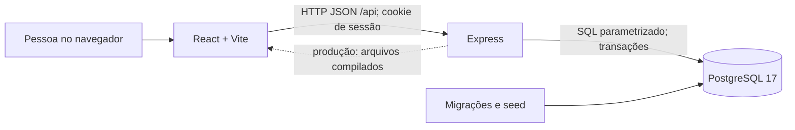
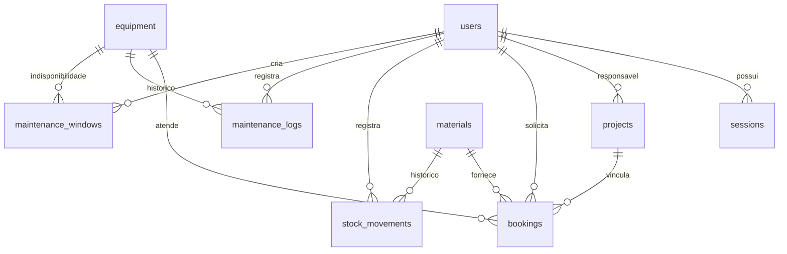

# Arquitetura do SIGES

Este documento descreve a implementação presente no repositório em 30/10/2026. Os documentos de requisitos da primeira entrega registram propostas e pendências daquele momento; para o funcionamento atual, consulte também o código e a [validação dos novos módulos](./validacao-novos-modulos.md).

## Visão geral

O SIGES é uma aplicação web em um monorepo npm. A interface é uma SPA React; ela chama uma API HTTP em Express, que concentra autenticação, permissões, regras de negócio e acesso ao PostgreSQL. Não há serviço externo obrigatório nem ORM. As consultas usam SQL parametrizado pelo pacote `pg`.

No desenvolvimento, Vite serve a interface em `127.0.0.1:5173` e encaminha `/api` à API em `127.0.0.1:3001`. Em produção, a própria API serve o diretório compilado `apps/web/dist`. O processo Node escuta em `127.0.0.1` por padrão; a implantação com acesso externo precisa de um proxy reverso com HTTPS. O `compose.yaml` fornece apenas o banco de desenvolvimento.

## Ferramentas, bibliotecas e tecnologias

- **Plataforma e linguagem:** JavaScript com módulos ES (`.mjs` e JSX), Node.js 24 ou superior, npm workspaces e HTML/CSS.
- **Interface:** React 19, React DOM 19, Vite 7, `@vitejs/plugin-react` e ícones `lucide-react`. O estado da interface usa hooks React; a navegação entre telas usa `location.hash`.
- **API:** Express 5, `zod` 4 para validação de entrada, `helmet` 8 para cabeçalhos de segurança, `express-rate-limit` 8 e `dotenv` 17 para configuração local. Hashes, tokens e comparação segura usam `node:crypto`.
- **Persistência:** PostgreSQL 17, driver `pg` 8, SQL e migrações versionadas. Docker Compose com imagem `postgres:17-alpine` ou `embedded-postgres` para banco local de desenvolvimento.
- **Qualidade:** `node:test` para integração HTTP, Playwright para testes de navegador, ESLint 9, Prettier 3 e `concurrently` para iniciar API e interface juntas.
- **Integração contínua:** GitHub Actions em `.github/workflows/ci.yml`, com PostgreSQL 17, lint, formatação, build, testes HTTP e testes Playwright em Chromium.
- **Referência visual:** capturas do protótipo em [`docs/Tela`](./Tela/) e o [índice dos protótipos](./prototipos.md). As imagens são referências de interface, não dependências de execução.

As versões acima são as linhas principais declaradas nos manifestos; o `package-lock.json` fixa as versões instaladas por `npm ci`.

## Organização do código

- `apps/web/src/main.jsx`: entrada da aplicação, sessão inicial, navegação, carregamento das coleções e telas de dashboard, agendamentos, manutenção e métricas.
- `apps/web/src/components/`: login, registros, formulários e diálogos. `apps/web/src/lib/api.mjs` centraliza `fetch`, cabeçalhos e tratamento de erros; `styles.css` define o layout responsivo.
- `apps/api/src/app.mjs`: middlewares, esquemas Zod, rotas REST, autorização, consultas e fluxos transacionais.
- `apps/api/src/security.mjs`: senha com `scrypt` e tokens de sessão. `database.mjs`: pool, transações, migrações e seed. `config.mjs` lê o ambiente; `server.mjs` inicia e encerra o processo.
- `apps/api/migrations/`: esquema SQL incremental (`001` a `004`), incluindo cadastros, agendamentos e janelas de manutenção.
- `tests/`: integração HTTP com PostgreSQL real e cenários de navegador em desktop e celular. `scripts/local-db.mjs` inicia o PostgreSQL embutido para desenvolvimento.

## Modelo de dados

Os IDs de domínio são UUID. `users` tem papel `manager` ou `user`; `sessions` guarda somente o hash do token. `equipment` e `materials` distinguem FDM e RESIN. Materiais FDM usam gramas (`g`), e resina usa mililitros (`ml`); as quantidades persistidas usam `numeric(12,3)`. `materials.physical` representa o saldo físico e `materials.reserved` o comprometido por reservas; o disponível é calculado como `physical - reserved`. Restrições SQL impedem saldo físico e reservado negativos. `stock_movements` registra autoria, motivo e saldo físico resultante. A reserva e a devolução geram registros de movimento sem alterar imediatamente o saldo físico.

`bookings` vincula usuário, projeto, equipamento, material, intervalo e estado. O campo legado `material_grams` também armazena a quantidade de resina, interpretada em `ml` conforme `materials.unit`. `maintenance_logs` registra serviços já realizados; `maintenance_windows` registra períodos programados, que bloqueiam reservas sobrepostas enquanto não concluídos. Cadastros podem ser inativados sem apagar vínculos históricos.

As migrações rodam em transação, com `pg_advisory_xact_lock`, e são registradas em `schema_migrations`. O seed é idempotente para os registros de demonstração e é bloqueado em produção.

## Fluxos e regras principais

1. **Sessão:** o login verifica a senha com `scrypt`, gera token aleatório e grava seu SHA-256 em `sessions`. O navegador recebe o token em cookie `HttpOnly`, `SameSite=Strict`, com expiração de oito horas e atributo `Secure` em produção. A API consulta a sessão a cada chamada protegida. Logout remove a sessão no servidor.
2. **Permissões:** rotas de cadastro operacional, movimentação de estoque, manutenção e métricas exigem gestor. Usuários comuns consultam os cadastros, administram seus projetos e seus agendamentos. A API valida autoria e papel; a ocultação de controles na interface é apenas apresentação.
3. **Agendamento:** a criação valida projeto, equipamento e material ativos, tecnologia compatível, horário futuro, disponibilidade de equipamento e manutenção, e saldo disponível. Em uma transação, trava as linhas de equipamento e material, grava a reserva e aumenta `reserved`. O cabeçalho `Idempotency-Key` permite repetir a criação para o mesmo usuário sem duplicá-la.
4. **Ciclo da impressão:** `scheduled → confirmed → in_progress → done` ou `interrupted`; `scheduled` e `confirmed` podem virar `cancelled` ou ser reagendados. Cancelar libera o reservado. Iniciar desconta a estimativa de `physical` e `reserved`. Encerrar ajusta `physical` pela diferença entre estimativa e consumo real e registra a movimentação. Os intervalos são tratados como `[início, fim)` nas verificações de conflito.
5. **Manutenção:** o gestor cria períodos preventivos ou corretivos, sem sobreposição com reservas ativas ou outras janelas abertas. Pode iniciar e concluir uma janela. Há também registro separado de manutenção realizada. O estado operacional mostrado para equipamento é calculado a partir das janelas e impressões em andamento.
6. **Leituras agregadas:** dashboard reúne contagens, reservas do dia e alertas de estoque; métricas de gestor agregam consumo por tecnologia, projeto e agendamento. A API retorna valores de filamento e resina em campos separados.

Todas as operações de escrita com várias consultas relacionadas usam transações onde implementado. As entradas passam por Zod, e conflitos de negócio retornam erros HTTP legíveis. A API desabilita `x-powered-by`, aplica `helmet`, limita tentativas de login, exige `X-SIGES-Request: 1` nas requisições que alteram estado e desabilita cache das respostas `/api`.

## Contrato HTTP

Todas as rotas abaixo têm prefixo `/api` e respondem em JSON, exceto respostas sem conteúdo. `/health` e `/auth/login` são públicas; as demais exigem sessão.

- Autenticação: `POST /auth/login`, `GET /auth/me`, `POST /auth/logout`.
- Cadastros: `GET/POST /users`; `GET/POST /projects`, `PUT /projects/:id`; `GET/POST /equipment`, `PUT /equipment/:id`; `GET/POST /materials`, `PUT /materials/:id`.
- Estoque: `GET/POST /materials/:id/movements`.
- Manutenção: `GET/POST /maintenance`; `GET/POST /maintenance/windows`; `PATCH /maintenance/windows/:id/status`.
- Agendamentos: `GET /bookings/mine`, `GET /bookings`, `GET /bookings/today`, `POST /bookings`, `PATCH /bookings/:id/cancel`, `PATCH /bookings/:id/reschedule`, `PATCH /bookings/:id/status`.
- Consultas: `GET /dashboard`, `GET /metrics` (aceita `from` e `to` em `YYYY-MM-DD`).

## Execução e verificação

As variáveis `DATABASE_URL`, `PORT`, `SEED_PASSWORD` e `NODE_ENV` são exemplificadas em [`.env.example`](../.env.example). O frontend em desenvolvimento pode receber `SIGES_API_TARGET` para apontar o proxy Vite à API. Para instalar, migrar, popular e executar, siga o [guia de desenvolvimento](./desenvolvimento.md).

Os comandos de verificação são `npm run lint`, `npm run format:check`, `npm run build`, `npm test` e `npm run test:e2e`. Os testes HTTP usam banco temporário PostgreSQL; os testes de navegador usam servidores próprios nas portas 3101 e 5174 e requerem migrações e seed. A CI executa a mesma sequência em ambiente descartável.

## Limites atuais

- A API, as consultas de domínio e as regras de negócio estão concentradas em `app.mjs`; não há camadas separadas de serviço e repositório.
- O frontend usa estado React local e recarrega coleções após gravações; não há cache de consultas ou atualização em tempo real.
- A detecção de sobreposição de agendamentos é feita em consultas e travas na API, sem uma restrição de exclusão SQL no esquema. O caminho de criação trava equipamento e material; os demais caminhos devem ser revistos se houver maior concorrência.
- No encerramento, quando o consumo real é exatamente igual à estimativa, a API tenta inserir um ajuste de quantidade zero em `stock_movements`, mas o esquema exige `quantity <> 0`. Esse caso precisa de correção no fluxo de encerramento.
- `compose.yaml` sobe apenas PostgreSQL. O repositório não contém definição completa de implantação, proxy HTTPS, recuperação de senha ou observabilidade de produção.
